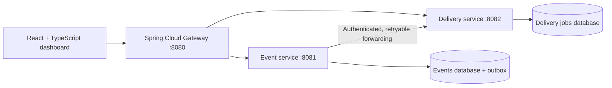

# RelayForge

**Webhook operations with Java Spring Boot microservices and React TypeScript.**

RelayForge accepts events durably, forwards them between independently running services through a transactional outbox, and shows the event ledger and delivery queue in a live dashboard.

   

## Stack

| Area | Technology |
| --- | --- |
| Backend | Java 21, Spring Boot 4.1.2, Java records, virtual threads |
| Gateway | Spring Cloud Gateway, Reactor Netty, Spring Cloud 2025.1.4 |
| Data | PostgreSQL, Spring JDBC, Flyway migrations; file-backed H2 for local development |
| Reliability | Transactional outbox, idempotent consumer, bounded HTTP timeouts, forwarding backoff |
| Frontend | React 19, TypeScript 7, Vite 8, TanStack Query |
| Verification | JUnit, Spring Boot integration tests, Vitest, React Testing Library, live service smoke tests |
| Delivery tooling | Multi-stage Docker builds, Compose, GitHub Actions |

## Working today

- Three separately executable Java services with health/readiness endpoints.
- Durable event acceptance with database-enforced idempotency and conflict responses.
- Atomic event-and-outbox transactions; failed service forwarding is retried.
- Independently persisted delivery jobs, deduplicated by event ID.
- An API gateway that routes public APIs while excluding internal intake.
- Internal service-token checks for delivery intake.
- Java HMAC-SHA256 signing and freshness-verification primitives.
- A React dashboard with actual event/job data, event creation, automatic refresh, and error states.

Pending delivery jobs are **not yet sent to external destinations**. Outbound workers, retry/dead-letter processing, OIDC authentication, and distributed tracing are roadmap items.

## Architecture



Each stateful service owns its database. See [architecture and guarantees](docs/ARCHITECTURE.md).

## Run locally

Requirements: Java 21, Maven 3.9+, and Node.js 20.19+ or 22.12+. Containers and CI use Node 22.

```bash
git clone https://github.com/Rajansharma0786/relayforge.git
cd relayforge
mvn verify
npm --prefix frontend ci
npm --prefix frontend test
npm --prefix frontend run build
```

Start each application in a separate terminal from the repository root:

```bash
java -jar services/delivery-service/target/delivery-service-0.1.0-SNAPSHOT.jar
```

```bash
java -jar services/event-service/target/event-service-0.1.0-SNAPSHOT.jar
```

```bash
java -jar services/api-gateway/target/api-gateway-0.1.0-SNAPSHOT.jar
```

```bash
npm --prefix frontend run dev
```

Open [the dashboard](http://127.0.0.1:5173). Vite proxies API traffic through the gateway. The default local profile uses separate persistent H2 files under `data/`. Services bind to loopback. Local service-token defaults are for this development setup.

## Run with PostgreSQL and containers

```bash
cp .env.example .env
docker compose up --build
```

Compose defines two PostgreSQL databases, three Java services, and the dashboard. Open [the dashboard](http://127.0.0.1:5173); the gateway is on [port 8080](http://127.0.0.1:8080/actuator/health). Compose uses development credentials from the example environment.

## Try the API

```bash
curl -i http://127.0.0.1:8080/api/events \
  -H 'Content-Type: application/json' \
  -H 'Idempotency-Key: invoice-paid-inv_123' \
  -d '{"eventType":"invoice.paid","destination":"https://example.com/hooks","payload":{"invoiceId":"inv_123","amount":4999}}'
```

Repeat the request to receive the same event with HTTP 200 and `Idempotency-Replayed: true`. A different event with the same key returns HTTP 409. Within a few seconds, the event becomes FORWARDED and its job appears in `GET /api/deliveries`.

## Verify the complete service flow

After `mvn verify`, run:

```bash
node scripts/smoke-test.mjs
```

The smoke test starts all three Java applications on available ports, verifies gateway routing, intake, replay, conflicts, internal-route isolation, and actual outbox forwarding, then stops its processes. It uses temporary in-memory H2 databases.

PostgreSQL integration is also exercised in CI. Environment variables for running that variant against disposable databases are documented in [development](docs/DEVELOPMENT.md).

## Documentation

- [Architecture and guarantees](docs/ARCHITECTURE.md)
- [API contract](docs/API.md)
- [Java signature contract](docs/SIGNATURES.md)
- [Development and daily automation](docs/DEVELOPMENT.md)
- [Prioritized roadmap](docs/ROADMAP.md)
- [Migration notes](docs/MIGRATION.md)
- [Progress and verification](docs/PROGRESS.md)

## Repository structure

```text
services/
  api-gateway/       Reactive API routing
  event-service/     Event ledger and transactional outbox
  delivery-service/  Job intake, persistence, and Java signing primitives
frontend/            React/TypeScript dashboard and tests
scripts/             JavaScript live-service smoke test
docs/                Architecture, API, roadmap, and progress
compose.yml          PostgreSQL and application development stack
```

Maintained by [Rajan Sharma](https://github.com/Rajansharma0786) with AI assistance from Codex, including regular scheduled development. Multiple commits may be published per session when they represent complete improvements.

[MIT license](LICENSE).
