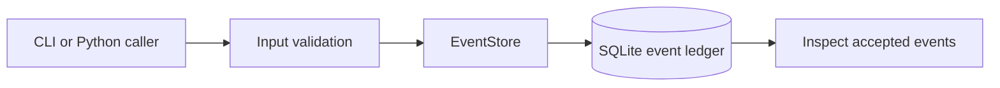
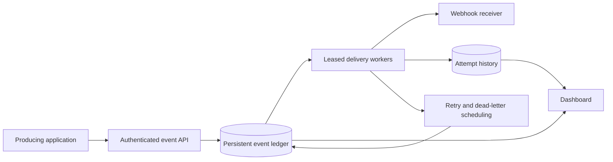

# Architecture

## Implemented boundary: event acceptance

The current core accepts JSON objects and persists them in SQLite. It does not perform outbound HTTP delivery. This makes acceptance, idempotency, and restart behavior testable without external services.

Every event has a UUID, event type, destination, JSON payload, pending status, creation time, and optional idempotency key. JSON is serialized with sorted keys and non-finite values rejected. Its serialization provides semantic object-key ordering for idempotent comparisons, not a cryptographic canonical JSON standard.

A unique database constraint arbitrates concurrent idempotency-key submissions. The insert happens before the lookup inside a transaction, avoiding a check-then-insert race. A repeated key returns the accepted event only when event type, destination, and serialized payload match. A conflicting request raises IdempotencyConflict. Events without keys are independent.

Use one EventStore instance per thread or process. Separate connections share the file through SQLite locking with a ten-second busy timeout. SQLite is a local development choice; distributed multi-host workers are a later storage milestone.

Schema version 1 intentionally permits only pending events. Future delivery states require a tested migration. The store rejects a higher schema version rather than guessing how to interpret it.

## Target system

This diagram is planned scope. Target semantics are at-least-once delivery: a worker crash after a receiver accepts a request can cause a duplicate. Receivers will need their own event-ID deduplication. Exactly-once delivery is not promised.

## Next design decisions

- Claim events with leases so a crashed worker can be recovered.
- Keep immutable attempt history separately from current delivery state.
- Use bounded timeouts, payload limits, exponential retry delays, and dead-letter handling.
- Verify response status, classify retryable failures, and restrict replay operations.
- Enforce safe outbound destinations, including resolved private addresses and redirect behavior, before introducing network dispatch.
- Add PostgreSQL when the concurrency and deployment milestones require it.

Current destination checks only validate URL shape; they are not an SSRF defense. Do not expose this core directly as a public service. Authentication, authorization, rate limiting, request-size limits, and secret provisioning are future API requirements.

## Validation sources

The transaction approach follows the [Python sqlite3 documentation](https://docs.python.org/3/library/sqlite3.html). The test suite exercises restart persistence, replay/conflict semantics, concurrent independent connections, invalid inputs, and CLI behavior. Full delivery integration and deployment have not been implemented.
